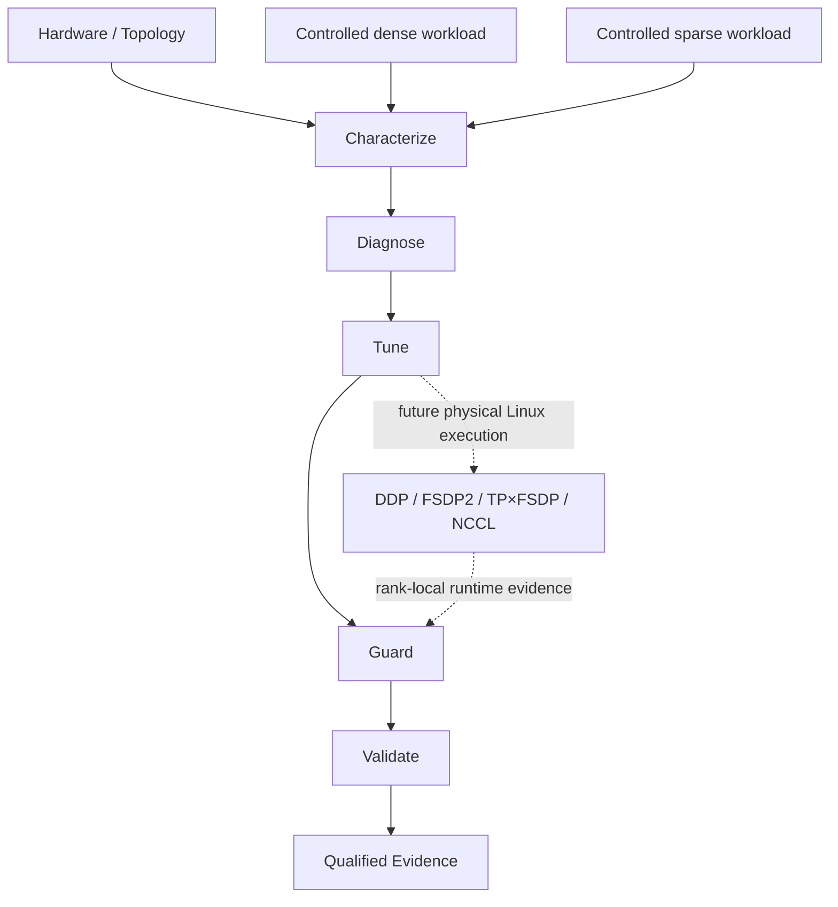

# NCCL-Guard

[](https://github.com/ReviveCoding/nccl-guard/actions/workflows/ci.yml)
[](https://www.python.org/)
[](https://pytorch.org/)
[](docs/CLAIM_LEDGER.md)

A topology-aware distributed-training characterization, configuration-selection, and reliability
framework built around PyTorch DDP/FSDP2/TP, NCCL integration, runtime evidence, and fail-closed
qualification.

> **Local implementation and single-GPU qualification are complete. Multi-GPU distributed
> performance remains intentionally unclaimed pending physical multi-GPU Linux hardware.**

## Key Results

All results below are **single-GPU** measurements from the tracked local qualification evidence.
They are characterization results, not distributed speedups.

| Qualified result | Evidence |
|---|---:|
| Hardware / precision | RTX 4090 Laptop GPU / BF16 |
| Dense protocol | 3 independent launch blocks |
| Dense input throughput | 10,603.67 median; 10,438.88 mean tokens/s |
| Representative mean update | 24.14 ms |
| Host-to-device transfer | 0.105 ms |
| Synthetic sparse control | 8,004.12 samples/s |
| Portability-hardened test suite | 45 pytest tests |
| Local checkpoint and application-state restore | PASS |

Sources: [local qualification report](reports/local_qualification.md) and
[tracked qualification summary](evidence/local_qualification_summary.json).

## Why NCCL-Guard

Distributed-training choices are coupled to model shape, communication volume, topology, and
failure behavior. NCCL-Guard turns those inputs into a reproducible workflow: characterize the
host, diagnose likely bottlenecks, search within a bounded budget, guard unsafe or incomparable
configurations, and validate claims against immutable evidence. Unsupported environments fail
closed instead of being presented as successful experiments.

## Architecture



The implementation applies tensor parallelism before FSDP2, wraps transformer blocks bottom-up
and then the root, creates the optimizer after sharding, and computes global batch and token counts
from the data-parallel degree.

## Experimental Protocol

- Comparable strategies use the same canonical model state and scheduled data identity.
- Correctness and performance modes remain separate; `torch.compile` is off for v1 headline work.
- Search observations are isolated from the untouched final-evaluation pool.
- Scaling studies distinguish strong from weak scaling and avoid invalid one-GPU efficiency claims.
- Exposed Communication Ratio uses rank-local timeline interval overlap; local profiler values are
  labeled `ECR_APPROX`, while authoritative `ECR_AUTH` requires Nsight evidence.

See [experiment design](docs/EXPERIMENT_DESIGN.md), [tuning fairness](docs/TUNING_FAIRNESS.md),
and [metrics](docs/METRICS.md).

## Local Results

The qualified dense run used BF16, deterministic scheduled samples, pinned host memory, nonblocking
H2D outside model timing, 10 warmup updates, and 50 measured updates per launch. Three independent
launch blocks produced a 10,603.67 tokens/s median and 10,438.88 tokens/s mean. The 24.14 ms update
is the representative launch mean; H2D averaged 0.105 ms in its dedicated measurement.

The sparse result is a schema-compatible **synthetic control**, not Criteo or distributed TorchRec
evidence. Local Distributed Checkpoint utilities restored model, optimizer, scheduler, RNG, step,
and deterministic data-cursor state; this is not elastic rank-failure recovery.

## Experiment Status

| Scope | Status | Claim boundary |
|---|---|---|
| Local CUDA dense and synthetic sparse characterization | PASS | One Windows GPU only |
| Local checkpoint/application-state restore | PASS | Utility recovery, not elastic distributed recovery |
| DDP/FSDP2/TP composition | CONDITIONAL | Source and control tests; Linux runtime pending |
| NCCL, multi-GPU scaling, RDMA, and multi-node performance | SKIP_UNSUPPORTED | No physical Linux multi-GPU evidence |
| Criteo systems result | SKIP_RESOURCE_BUDGET | Full corpus intentionally not downloaded |
| Overall distributed benchmark | **HOLD** | Required distributed primary evidence is absent |

The authoritative boundary is maintained in the [claim ledger](docs/CLAIM_LEDGER.md).

## Reliability & Evidence Discipline

NCCL-Guard records explicit `PASS`, `FAIL`, `SKIP_*`, and `INVALID_CONFIGURATION` outcomes. A skip
is never success. Evidence writers use immutable run directories and SHA manifests; excluded runs
stay documented rather than silently disappearing. Checkpoints include application state, and the
framework makes no duplicate-free or skip-free world-size-changing recovery claim without verified
global sample-ID remapping. See the [adversarial review](reports/adversarial_review.md) and
[fault/recovery contract](docs/FAULT_AND_RECOVERY.md).

## Repository Structure

| Path | Purpose |
|---|---|
| `src/nccl_guard/` | Models, parallel composition, metrics, tuning, recovery, and CLI |
| `configs/` | Workload, strategy, topology, and experiment definitions |
| `scripts/linux/` | Fail-closed native-Linux NCCL qualification launchers |
| `scripts/windows/` | Local Windows CUDA bootstrap and verification |
| `tests/` | Correctness, fairness, portability, and contract tests |
| `evidence/` | Small tracked summaries; raw runtime artifacts remain ignored |
| `docs/` and `reports/` | Protocols, runbooks, claim ledger, and technical findings |

## Quick Start

Python 3.11 or newer is required. Install the PyTorch build appropriate for the target platform
from the official PyTorch instructions, then install NCCL-Guard:

```bash
python -m venv .venv
source .venv/bin/activate
python -m pip install -e '.[dev]'
nccl-guard --help
nccl-guard doctor
```

On Windows PowerShell, the repository-local bootstrap is:

```powershell
scripts\windows\bootstrap_local.ps1
.\.venv-core\Scripts\nccl-guard.exe doctor
```

These commands do not turn a CPU runner or native Windows into an authoritative NCCL host.

## Distributed Handoff

Authoritative distributed work starts on an exclusive, native Linux 2/4/8-GPU NCCL host. WSL is
rejected, Linux uses a separate `.venv-linux-core`, and `nccl-tests` is pinned to an exact revision.
Follow the [single-node GPU runbook](docs/SINGLE_NODE_GPU_RUNBOOK.md) or
[multi-node GPU runbook](docs/MULTI_NODE_GPU_RUNBOOK.md). Do not substitute Gloo results for NCCL
qualification.

## Technical Report

The canonical GitHub report is [reports/technical_report.md](reports/technical_report.md). Supporting
detail is available in the [local qualification report](reports/local_qualification.md),
[adversarial review](reports/adversarial_review.md), and [execution state](docs/EXECUTION_STATE.md).

## Limitations

There is no qualified NCCL speedup, DDP/FSDP2/TP scaling result, distributed recovery timing,
multi-node result, authoritative Nsight ECR, or real distributed final-evaluation pool. GitHub
Actions validates source, packaging, and shell contracts on CPU runners; it is not GPU or NCCL
qualification. No license has been selected for this repository.

## Roadmap

1. Execute the frozen single-node matrix on physical native-Linux 2/4/8-GPU NCCL hardware.
2. Collect rank-local Nsight timelines and promote eligible overlap measurements to `ECR_AUTH`.
3. Run untouched distributed evaluation and controlled elastic recovery experiments.
4. Extend qualification to an explicitly documented multi-node fabric and topology.

The [scientific protocol](docs/SCIENTIFIC_PROTOCOL.md) records hardware restrictions, scaling semantics, benchmark fairness requirements, and checkpoint validity criteria.
