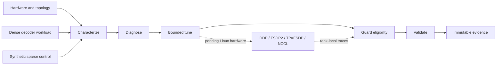

# NCCL-Guard Technical Report

## Executive Summary

NCCL-Guard is an evidence-backed framework for characterizing distributed-training systems,
selecting guarded configurations, and testing reliability behavior across PyTorch DDP, FSDP2,
tensor parallelism, and NCCL-oriented execution paths.

The implementation and bounded local CUDA qualification are complete. On a single NVIDIA GeForce
RTX 4090 Laptop GPU, three independent BF16 dense launch blocks produced 10,603.67 median and
10,438.88 mean input tokens/s. A synthetic sparse control produced 8,004.12 samples/s, and local
checkpoint/application-state restore passed. These are **single-GPU characterization results**.

The distributed research question remains unanswered because the qualification host is native
Windows with one GPU and no NCCL. No NCCL speedup, DDP/FSDP2/TP scaling, RDMA, multi-node,
authoritative Nsight ECR, or elastic distributed-recovery result is claimed. Overall benchmark
verdict: **HOLD**.

## System Design

The source includes a RoPE causal decoder, deterministic sample scheduling, DDP/FSDP2/TP×FSDP
composition, rank-local overlap metrics, bounded nested search, immutable evidence writing,
Distributed Checkpoint integration, fault scheduling, and E00–E12 orchestration.

Distributed composition follows these invariants:

- Tensor parallelism is applied before FSDP2.
- FSDP2 is applied bottom-up to transformer blocks and then to the root.
- The optimizer is constructed after sharding.
- Tensor-parallel divisibility is validated before execution.
- Global batch and token counts use the data-parallel degree, not total world size.

## Experimental Controls

Comparable strategies share a canonical initial model state and data identity. Correctness-mode and
performance-mode executions are distinct, and `torch.compile` remains disabled for v1 headline
comparisons. Strong and weak scaling are separate studies. Search observations are isolated from
an untouched final-evaluation pool, the final workload/topology transaction remains unopened, and
NCCL-Guard's own characterization cost is included in tuning-cost accounting.

The full oracle table is never exposed to the selector. Trainer Communication Efficiency is only
eligible when collective type, rank count, datatype, message-size regime, node count, and topology
are comparable. Exposed Communication Ratio is based on rank-local interval union and overlap—not
summed collective time across ranks. Local profiler evidence is explicitly approximate; only
eligible Nsight traces can support `ECR_AUTH`.

## Qualified Local Evidence

| Measurement | Qualified value | Boundary |
|---|---:|---|
| GPU / precision | RTX 4090 Laptop GPU / BF16 | Native Windows, one GPU |
| Dense launches | 3 independent blocks | 10 warmup + 50 measured updates each |
| Dense throughput | 10,603.67 median; 10,438.88 mean input tokens/s | Single configuration, no speedup claim |
| Representative update | 24.14 ms mean | Representative dense launch |
| Host-to-device transfer | 0.105 ms | Dedicated local measurement |
| Synthetic sparse control | 8,004.12 samples/s | Not Criteo or TorchRec evidence |
| Checkpoint/application state | PASS | Local utility, not elastic recovery |
| Portability-hardened tests | 45 PASS | Prior tracked qualification result |

The dense protocol used persisted deterministic data through scheduled sample IDs, pinned host
memory, and nonblocking H2D outside model timing. The local checkpoint utility restored model,
optimizer, scheduler, step, Python/NumPy/Torch/CUDA RNG state, and deterministic global data cursor.

Source evidence:

- [Qualification summary](../evidence/local_qualification_summary.json)
- [Local qualification report](local_qualification.md)
- [Checkpoint evidence](../evidence/local_checkpoint_check.json)
- [Execution state](../evidence/execution_state.json)

## Qualification Matrix

| Research claim | State | Reason |
|---|---|---|
| Local CUDA BF16 dense training | SUPPORTED | Three valid benchmark-semantics v2 launch blocks |
| Synthetic sparse CUDA control | SUPPORTED | Bounded schema-compatible local control |
| Local application-state restore | SUPPORTED | Model, optimizer, scheduler, RNG, step, and cursor restored |
| DDP/FSDP2/TP composition | CONDITIONAL | Implemented and contract-tested; physical Linux runtime pending |
| NCCL/DDP/FSDP2/TP performance | UNSUPPORTED | No native-Linux multi-GPU execution |
| RDMA or multi-node behavior | UNSUPPORTED | No fabric evidence |
| Elastic fault recovery | UNSUPPORTED | Requires executed Linux multi-GPU E10 |
| Guard held-out distributed performance | UNSUPPORTED | No real independent distributed evaluation pool |

The machine-readable and narrative authority is the [claim ledger](../docs/CLAIM_LEDGER.md).

## Reliability and Auditability

Experiment results use explicit `PASS`, `FAIL`, `SKIP_UNSUPPORTED`, `SKIP_NEEDS_CREDENTIALS`,
`SKIP_VERSION_MISMATCH`, and `INVALID_CONFIGURATION` states. Skips never count as successes.
Immutable run directories and SHA manifests protect finalized evidence. Scientifically invalid or
superseded runs remain listed in the execution state with exclusion reasons.

Distributed checkpoints use PyTorch Distributed Checkpoint state-dict APIs and explicitly include
application state. The framework does not claim duplicate-free or skip-free world-size-changing
recovery without implemented and verified global sample-ID remapping.

The completed [adversarial review](adversarial_review.md) covers numerical correctness,
distributed semantics, data leakage, benchmark fairness, portability, and claim boundaries. It
records fixes for timing contamination, scheduled-data identity, evaluation leakage, application
state restoration, TP batch arithmetic, fail-open Linux launch gates, and bootstrap portability.

## Data and Reproducibility

Only bounded public data is permitted. Dataset manifests record source and transformation details;
full C4 and large Criteo corpora are intentionally excluded. A failed bounded Criteo acquisition
is reported as a resource-budget skip, not silently replaced by another dataset.

Raw datasets, profiler binaries, checkpoints, environments, and runtime artifacts are ignored.
Small claim-bearing summaries are tracked under `evidence/`. Authoritative distributed execution
must follow the [single-node](../docs/SINGLE_NODE_GPU_RUNBOOK.md) or
[multi-node](../docs/MULTI_NODE_GPU_RUNBOOK.md) runbook on suitable native Linux hardware.

## CI Boundary

GitHub-hosted CI performs CPU-only formatting, linting, typing, tests, package build/smoke checks,
Linux shell contract validation, and Windows PowerShell parsing. PyTorch is installed from the
official CPU wheel index. CI does not execute CUDA, NCCL, GPU benchmarks, datasets, or distributed
qualification and therefore creates no new performance evidence.

## Conclusion

NCCL-Guard provides a tested implementation, a disciplined selection protocol, and credible local
CUDA evidence while preserving the line between implementation readiness and distributed systems
qualification. The current result is locally qualified and ready for the frozen Linux handoff, but
the only scientifically valid distributed benchmark verdict remains **HOLD** until physical
multi-GPU evidence is collected.
